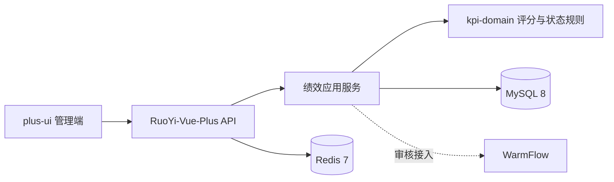

# 基础架构基线

## 固定版本

| 层级 | 选择 | 固定方式 |
| --- | --- | --- |
| 管理端 | RuoYi-Vue-Plus plus-ui 6.0.0 | `frontend/` 的锁文件 |
| 服务端 | RuoYi-Vue-Plus 6.0.0 | Git 子模块，提交 `7180b529776834fee912113b23f0bd7a387a8222` |
| 运行时 | Java 21、Spring Boot 4、MySQL 8、Redis 7 | 后端父 POM 与 `deploy/compose.yaml` |
| 规则内核 | `kpi-domain` | 独立 Java 模块 |
| 应用层 | `kpi-application` | 用例服务与持久化端口，不依赖 Web/ORM |
| 持久化适配器 | `kpi-infrastructure-jdbc` | 事务性 JDBC 实现，后续由 RuoYi/MyBatis 注入数据源 |
| RuoYi 接入层 | `kpi-ruoyi-adapter` | RuoYi 登录态、Spring Bean 与 JDBC 端口装配 |

## 模块边界

- RuoYi-Vue-Plus 负责账号、组织、角色、菜单、数据权限、审计和通用后台能力。
- `kpi-domain` 只承载周期、单位、指标版本、评分计算和提交状态机，不能依赖 Web、ORM 或工作流实现。
- `kpi-application` 负责鉴权后的用例编排，定义快照读取与提交写入端口；RuoYi/MyBatis 适配器将在此边界之外实现。
- `kpi-infrastructure-jdbc` 已实现周期与单位快照端口：单位导入在单一事务中替换草稿周期范围，并使用 `FOR UPDATE` 锁定周期行。
- 指标版本以“发布即冻结”的方式写入 `indicator_version` 与 `indicator_item_snapshot`；评分只读取已发布版本。
- `kpi-storage/migrations` 以版本化 SQL 建立绩效快照、审计事件和 Outbox；业务表不得直接修改已发布考核的历史快照。
- KPI 权限采用两层校验：RuoYi 登录用户先映射为时效性业务角色，再按考核周期和单位快照校验数据范围；校级管理员与考核办具有全周期范围，其余角色必须存在显式范围授权。
- WarmFlow 不在基础阶段启用。审核节点、退回规则和代办策略经制度确认后再接入，避免用流程引擎替代业务规则。

## 本地启动顺序

1. 复制 `deploy/.env.example` 为 `deploy/.env`，填入仅限本地使用的密码。
2. 在 `deploy/` 执行 `docker compose up -d`，等待 MySQL 与 Redis 健康。
3. Compose 会按顺序初始化 RuoYi-Vue-Plus 官方基础 SQL 和 `backend/kpi-storage/migrations/`；该过程仅发生在新的 MySQL 数据卷首次启动时。
4. 启动 `backend/ruoyi-vue-plus/ruoyi-admin`，并用 `--spring.config.additional-location=optional:file:../../deploy/backend-config/` 加载本地连接配置。
5. 在 `frontend/` 执行 `pnpm dev`，完成登录、菜单和鉴权联调。

## 基础阶段验收

- 前后端可启动，健康检查与登录可用；
- 通用账号、角色、菜单和数据权限由 RuoYi 管理；
- 绩效迁移可重复执行，约束、外键与审计表存在；
- `kpi-domain` 规则校验保持可独立运行；
- 前端不得通过演示白名单进入生产构建，演示开关只存在于 `.env.development`。

后端构建在受限网络中使用 `deploy/maven-settings.xml` 将上游的 `public` 仓库镜像到 Maven Central。

业务开发从“考核周期与单位分类”开始，随后依次接入指标版本、材料、填报、审核和归档。
